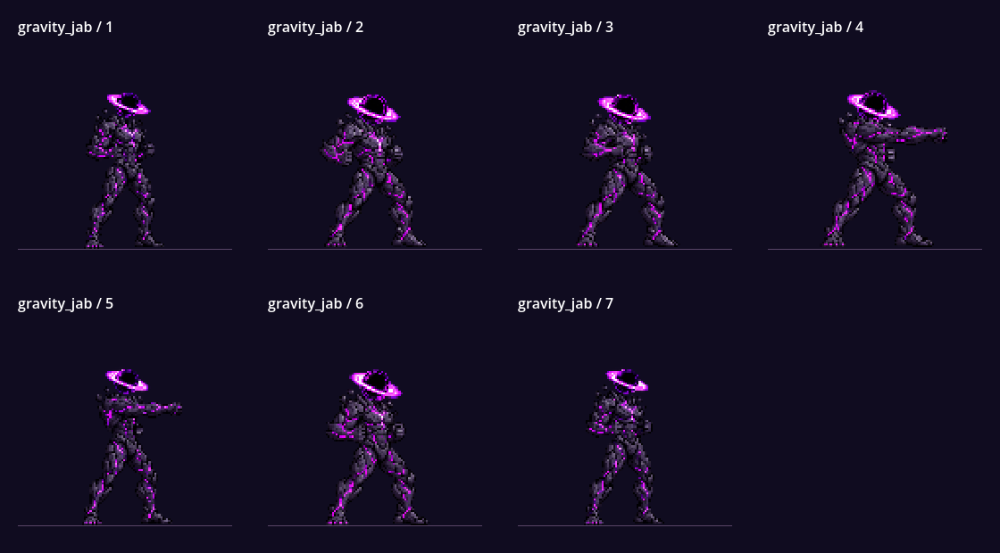
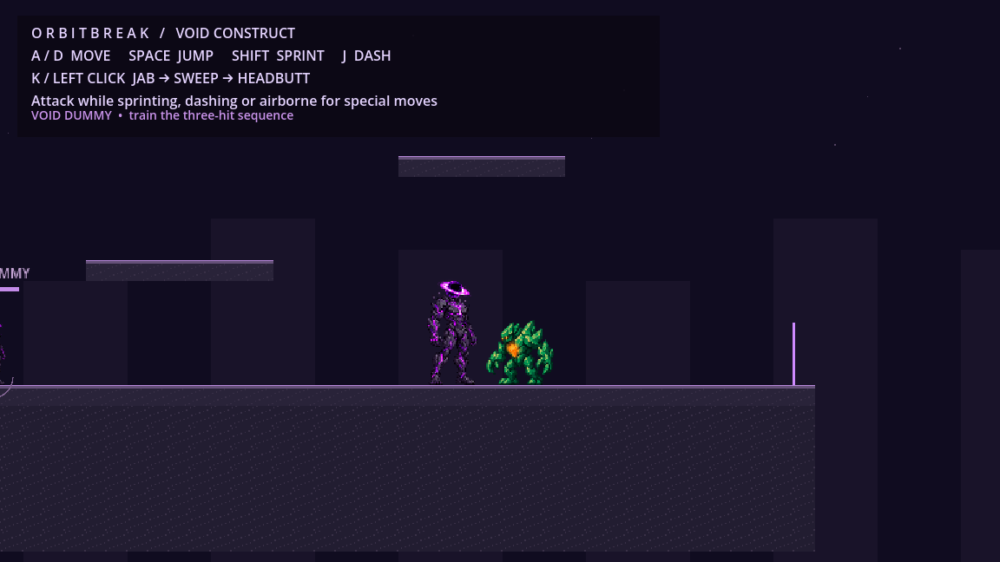

# Void Construct animation audit

## Status and benchmark

The user's latest `main` was the starting point, including their project and resource edits. The approved idle is the benchmark and is preserved exactly: eight original PNG files, original order, 8 FPS, loop enabled and every multiplier equal to 1. Tests compare file hashes and resource metadata against preservation fixtures.

**The exact user-supplied 12-pose run preview has not been imported.** Its original PNG/ZIP is still needed. The active eight-pose run is explicitly provisional. Sprint intentionally references those same run frames faster with separate ghosts, following the user's later override of the original request for distinct sprint artwork. Passing implementation tests does not make this pending art replacement complete.

## Problems found

- The earlier run's solid silhouette height varied from 66 to 79 pixels across eight frames despite a fixed baseline. Some variation came from pose, but head-width measurements also showed inconsistent source camera scale. Resizing every folded pose to a standing height would hide the issue by distorting animation scale, so the exact supplied sheet is awaited instead.
- Run and sprint originally gave every frame equal weight. Eight run drawings at 12 FPS took about 0.667 seconds per cycle while the controller moved 160 pixels at full run speed, contributing to visible foot sliding. The provisional retime uses a shorter, weighted cadence; it is not a replacement for correct contact and passing drawings.
- The old manual attack selector used `int(progress * count)`, ignoring SpriteFrames duration multipliers. Hit windows could consequently show anticipation instead of extension/impact when timing was adjusted.
- The basic jab needed a clear shoulder-driven chain and distinct windup/rotation/recovery. Temporary impact flashes, trails and shockwaves were present in selected character drawings.
- The existing jump/fall artwork was useful. The transition needed to follow actual ascent/apex and add a short, cancelable landing drawing rather than recreate good art or delay input.
- The enemy's origin is at its feet. A line-of-sight ray aimed there intersected the floor and rejected otherwise valid attacks. A body-center combat target point corrects that case.
- The user's serialized input event device IDs did not match device-0 events in the available engine. Only those IDs were changed to wildcard values; the keys, actions and project version setting remain intact.

## Per-animation decisions

| Animation | Decision and result |
|---|---|
| Idle | Preserve all pixels and all playback metadata. No regeneration. |
| Run | Major replacement still pending original supplied 12-pose sheet. Existing eight drawings remain provisional with weights `[1.15, 0.8, 1.0, 0.85]` repeated, base 20 FPS and velocity-aware playback. Do not call the supplied art imported. |
| Sprint | Reuse exact run frame references/order at base 28 FPS. Preserve stride phase when shifting between run and sprint. Add faint, separately timed ghosts only while grounded and moving quickly. |
| Gravity Jab | Starting/impact/return key poses were established before rotation/extension/recoil breakdowns. Seven complete drawings now show ready → anticipation → shoulder rotation → extension → impact → recoil → ready. The shoulder and elbow remain readable; no limb rig or stretching is used. |
| Jump | Preserve all four original PNG bytes. Short takeoff timing, longer rise/apex emphasis, and physical vertical-velocity selection clarify the action. |
| Fall | Preserve all four original PNG bytes. Use unequal timing and hold the final drawing if needed. |
| Landing | Reuse `fall_03`, `jump_00`, `fall_02`, `idle_00` at 16 FPS with weights `[0.5, 0.9, 0.7, 0.7]`. Cancel immediately on locomotion/jump/dash/attack. |
| Dash | Preserve useful beginning/recovery drawings; repair temporary trail-bearing poses and retime the sequence. Dash physics are unchanged. |
| Airborne smash | Preserve clean beginning/end drawings and the successful dramatic pose design. Repair the plunge/impact/crouch drawings to remove temporary effects. Hold a complete plunge drawing during physical descent, advance to impact on landing, and use a separate one-shot shockwave. |
| Repulsion sweep | Preserve useful ready/windup/recovery; repair affected sweep/impact/follow-through drawings and retime them. |
| Singularity headbutt | Preserve ready/windup/recovery; repair affected action/impact drawings. Independent weighted hitstop and restrained confirmed-hit feedback remain. |
| Sprint attack | Preserve useful approach, preparation and recovery; repair affected impact/follow-through art and give the move readable anticipation/recovery. |
| Dash attack | Repair the temporary-effect-bearing action drawings and retain recovery. Separate trail VFX from body playback. |
| Grapple / swinging | Not implemented; no animation was added. |
| Absorption / capture | Not implemented; no animation was added. |
| Weapon attacks / transformation | Not implemented; no weapon or transformation system was added. |

## Authored timing and gameplay events

Duration multipliers now have runtime effect. The sprite wrapper maps normalized combat progress through the cumulative weights, and the combat controller derives active windows from the same drawing boundaries. This keeps damage, displayed pose and confirmed-hit hitstop on one clock.

The seven jab weights are `[0.6, 1.25, 0.65, 0.35, 1.1, 1.15, 0.7]`; active drawings are zero-based 3–4. The six-pose moves use active drawings 2–3. Move durations are 0.34 seconds for jab, 0.44 for sweep, 0.58 for headbutt, 0.46 for sprint attack, 0.36 for dash attack and nominally 0.55 for smash. A smash can hold its plunge drawing during actual descent for a bounded time; physics continue running.

The longer anticipation and recovery drawings provide readability, short extension intervals provide speed, and impact emphasis stays visible during hitstop. Normal movement parameters, responsive cancellation and the fixed body capsule are preserved. The character is always one full-body image; no per-limb nodes, skeletal interpolation or whole-body transform animation was reintroduced.

## Character art versus temporary VFX

The black spherical head and its normal accretion ring remain permanent design features in the character art. Selected temporary-effect-bearing dash and attack poses were replaced with clean drawings while unaffected images were reused. The exact repaired files/regions and timing are listed in `Assets/VoidConstruct/QualitySources/manifest.json`.

`GravityVFX` now receives discrete attack-release, confirmed-impact, landing and smash-contact events. Each effect has its own real-time lifetime. Changing animation speed cannot replay an effect continuously or stretch its lifetime. The smash ground ring/debris and sprint/dash ghosts are independent nodes/effects, not painted into the hero. The work does not add absorption particles or grapple effects because those mechanics do not exist.

## Basic crystallized enemy

One Crystal Sentinel is placed at `(720, 448)` on the existing ground platform. It uses five original full-body sprites: idle, two walk poses, hurt and defeated/shattered. Its intentionally small behavior set is approach, telegraph, one short swipe, cooldown, stagger and defeat. It checks footing before advancing, has 40 health, reacts to melee/gravity/hitstop and cannot repeatedly connect one swipe.

Player response is localized knockback, brief invulnerability and hit flash; there is no new health, inventory or progression system. The training dummy remains available for stationary combo tests.

## Rendered gameplay review

Actual Godot playback was captured and inspected at jab contact, sprint, enemy windup/hit and smash landing. The live interaction recorded the enemy taking damage and the player receiving one enemy hit. These are gameplay captures from the integrated project:

The virtual display reported a VSync capability warning during rendered playback; it did not prevent rendering or the interaction checks. The headless editor import and seven regression suites below were clean.

## Verification and limits

A clean Godot 4.6.3 editor import and all seven suites completed with exit code 0 and no engine errors or warnings:

| Suite | Checks | Evidence |
|---|---:|---|
| Movement | 21 | Physical-key/mouse matching across device IDs; original speeds, jumps, coyote/buffer/dash and respawn. |
| Platform/layering | 6 | Actual landings on all three slabs; foreground sprite and stable body parent. |
| Animation | 88 | Exact idle preservation; original jump/fall bytes; full canvases; weighted timing; identical run/sprint art; apex/hold behavior; stable transforms. |
| Combat | 33 | Three-stage inputs/damage, contextual moves, buffering, once-per-target hits, hitstop, cancellations, walls and dummy reformation. |
| Timing/VFX | 32 | Weighted frame boundaries, pose-aligned active windows, one-shot release/contact effects, real-time lifetime and cancelable landing. |
| Crystal enemy | 26 | Real enemy spawn, approach, ledge awareness, telegraph/cooldown, hit/gravity response and defeat. |
| Sprint trails | 8 | Real-time cadence, playback-speed independence, emission conditions and cleanup. |

The player-only tests remove the enemy fixture so it cannot legitimately interrupt isolated movement measurements; the dedicated enemy test covers interaction. Fixtures live under `Tests/fixtures`.

The retained `QualitySources/manifest.json` overlay was reapplied after import and reproduced every character PNG plus the SpriteFrames resource byte for byte. Full-precision JSON serialization preserves normalization values through that round trip. Idle is not listed in the overlay. After rebuilding, editor import was clean and the 88-check animation suite passed again; the rebuilt asset hashes matched the build used for all seven suites.

Numerical checks and the inspected playback samples cannot certify every motion arc or professional art quality. The exact supplied run-sheet replacement is still an external asset dependency.
